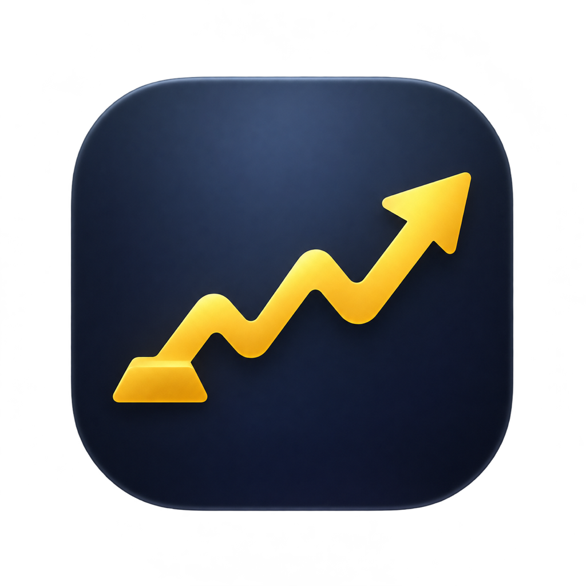

# 行情栏 · MarketBar

原生 macOS 菜单栏应用。启动后顶部菜单栏显示浙商积存金价格，点击价格可查看全部行情和设置。应用没有 Dock 图标。

## 打开

- 使用预编译版：在 Finder 中打开 `MarketBar.app`。当前预编译版适用于 macOS 14 或更新版本的 Apple Silicon Mac。
- 更新应用时先退出旧版，再用新版替换原来的 `MarketBar.app`。自选股和设置会保留。
- 从源码编译：在源码目录运行 `./script/build_and_run.sh`。需要 Xcode 或 Command Line Tools。生成的应用在 `dist/MarketBar.app`，也可单独打开。

## 使用

| 功能 | 操作 |
| --- | --- |
| 查看行情 | 点击顶部价格打开看板，在自选列表切换品种。可按「全部」或「持仓」筛选，报价时间使用北京时间 |
| 添加自选 | 点击「添加自选」，输入 `600519`、`159934`、`00700` 或 `AAPL` |
| 记录持仓 | 在报价卡片中点击「录入持仓」或「编辑持仓」。积存金按克填，股票按股填，ETF 按份填 |
| 查看总盈亏 | 看板按币种汇总当前持仓的浮动盈亏和已登记卖出的已实现盈亏。缺成本或报价时只显示已知部分 |
| 设置成本价 | 输入每克、每股或每份的平均成本，使用品种的报价币种。保存后，看板会按报价显示持仓市值和浮动盈亏 |
| 加仓或减持 | 从报价卡片或持仓设置打开「加仓」或「减持」，录入成交份额、单价和手续费。确认前可预览变动后的持仓 |
| 指定市场 | 可输入 `sh600519`、`sz159934`、`bj920088`、`hk00700` 或 `usAAPL`。例如上证指数使用 `sh000001` |
| 固定或轮播 | 在「设置 → 菜单栏」选择显示方式，指定品种和每项停留时间 |
| 自定义文字 | 可选名称和价格、代码和价格或仅价格，也可加上涨跌幅 |
| 定时刷新 | 「设置 → 更新与通知」默认每 5 分钟刷新，可改为 1–120 分钟 |
| 价格通知 | 在同一页开启「发送行情通知」并允许系统通知。默认每 30 分钟，可改为 1–1440 分钟，内容可选积存金或积存金和自选股 |
| 价格提醒 | 在「设置 → 价格提醒」新增规则。选品种、参考价格、方向和阈值，支持涨跌幅或每单位价格变动金额 |

通知从开启时起按设定间隔发送，应用须运行且 Mac 醒着。「现在发送一条」可验证通知权限和内容。行情失败时会显示上次成功取得的价格并标注缓存。休市或报价源延迟时，报价时间可能早于拉取时间。

价格提醒在刷新时检测。达到阈值时通知一次，回到阈值范围内或昨收更新后可再次触发。定时通知和价格提醒可分别使用，均需要系统通知权限。

持仓市值为份额乘以报价。浮动盈亏为持仓市值减去份额乘以单位成本。可以先保存份额，随后补录成本价。移除自选股后，重新添加同一代码会恢复先前录入的份额和成本价。

加仓按加权平均成本计算，买入手续费计入成本。减持沿用原来的平均成本，已实现盈亏等于卖出成交金额减去手续费和卖出部分的成本。现有成本未知时仍可记录操作，对应的成本或盈亏会显示为未知。减持至零后，交易记录仍在持仓设置里。如果录错，可在手工修改持仓前撤销最近一笔。

## 数据来源

- 浙商积存金取自[京东金融浙商积存金渠道](https://m.jdjygold.com/finance-gold/gold-standard/home/?productSku=1961543816)的公开报价，单位为人民币元/克。
- 自选股通过[腾讯财经行情](https://qt.gtimg.cn/q=sh600519)批量查询，价格按各市场币种显示。
- 两个接口均可匿名读取，不用设置 API Key。自选列表、持仓、偏好和最近报价保存在本机。

版本变更见 [CHANGELOG.md](CHANGELOG.md)。
